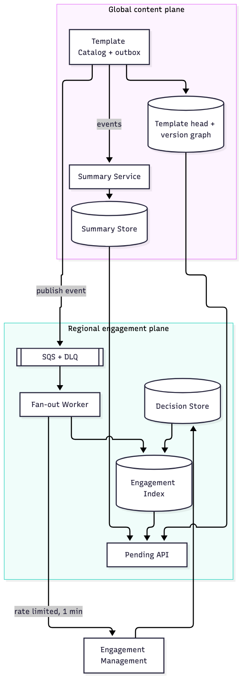
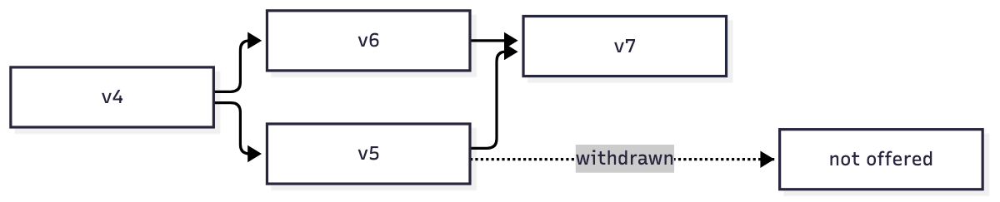

# Pending Template Updates for Engagement Files

Design document for the CaseWare Java Staff take-home.

## Summary

The feature answers two questions: which engagement files have pending template updates, and what changed. Pending state is derived from a small engagement metadata index, summaries are generated per version range from the template diff, and the slow one minute per engagement fan-out is asynchronous and never gates the indicator.

## 1. Architecture and data ownership

Two planes. The **global content plane** holds product templates, the version graph, diffs, and summaries. None of it is firm specific, so it can live in one region. The **regional engagement plane** holds engagement metadata, the pending index, decisions, queues, checkpoints, workers, and the pending API. Each region (EU, Canada, rest) has its own copy, and engagement data does not cross regions.

| Component | Responsibility | Data owned | Scope |
|---|---|---|---|
| Template Catalog (existing) | Store versions and the version graph. Add an outbox. | Template content, versions, parents, status, market | Global |
| Summary Service | Diff a range and produce an immutable structured summary | Summaries, hashes, model and prompt metadata | Global |
| Engagement Index | Project engagement metadata and derive pending state | Firm, engagement, region, template, market, baseline | Regional |
| Fan-out Worker | Page the index and call the slow downstream with quota, retries, idempotency, and checkpoints | Work state, checkpoints, DLQ | Regional |
| Pending API | Serve the inbox and the detail view | None, reads the index and summaries | Regional |
| Decision Recorder (existing) | Record accept and decline decisions and emit events | Decision history | Regional |

The key move is that a publish updates `template_head(template_id, market, latest_version)`, a table with tens of rows. The indicator is derived at read time by joining a firm's engagements against the head and the decision history. A publish does not write 800,000 rows. The fan-out worker is the slow path, and the indicator never waits for it. `markPending` updates the engagement-side pending state used by the apply path, not the inbox indicator, so a lagging fan-out cannot hide a pending update.

On AWS: EventBridge and SQS with DLQ per region, ECS Fargate workers, Aurora PostgreSQL per region for the index, S3 with Object Lock for summaries, DynamoDB for heads and summary lookup, Lambda and Bedrock for summaries, API Gateway, and CloudWatch with X-Ray.

Ownership follows the plane: template versions, diffs, and summaries are global; engagement metadata, index, decisions, queues, and checkpoints are regional.

## 2. Correctness and production evolution

### Invariants

1. The baseline is a published version the engagement actually has. After a withdrawal, it is the previous applied version reported by the engagement system.
2. A withdrawn version is never offered.
3. A declined version is not pending again unless a new head reincorporates it.
4. Accepting applies the range the user saw, not the head at click time.
5. A decision batch is atomic and idempotent by batch id.
6. The head only moves forward, except on withdrawal.
7. A summary is immutable and tied to its range and input hash.

Invariant 4 prevents a race. If v8 is published while the user is looking at v7, accepting sets the baseline to v7 and v8 stays pending. Without it, a concurrent publish changes what the user approved.

### Version semantics

Versions form a DAG per template and market. The head is the published, non withdrawn version with the highest `published_at`, with `sequence` as tiebreak. Only the head is offered, and the offer is the net diff from baseline to head.

Accept moves the baseline to the head that was shown. Decline writes one decision row per version in the range and leaves the baseline unchanged. Withdrawal removes the withdrawn version from any pending range. If it is not the head, the head is unchanged. If it is an accepted baseline, the baseline moves to the previous applied version reported by the engagement system and pending state is recomputed; rolling back the content is out of scope. If the engagement system cannot report the previous applied version, the offer is stopped and the engagement is flagged for manual review, because the DAG alone cannot prove the applied content. Reincorporation is detected by content identity (`change_key` plus an effect check on the normalized path). The net diff can remove changes previously applied, and the summary flags that, as well as a head that excludes a published sibling branch.

### Reliable events

Both source systems write an outbox row in the same transaction as the state change, and a CDC publisher sends events to EventBridge. Delivery is at least once, consumers are idempotent by event id plus natural key, and ordering is not assumed: a head update only advances if `published_at` is newer, and a withdrawal only moves the head if the withdrawn version is the current head. Poison events retry with backoff and jitter, then go to DLQ with replay. A daily reconciliation catches gaps.

The downstream contract is explicit: `markPending` receives an idempotency key (`eventId:engagementId`) and a timeout of about 90 seconds, and the implementation must honor both. A lost response after a successful call is ambiguous, so without downstream idempotency or a status check the worker cannot guarantee a single effect. The token bucket and the concurrency limiter are shared across workers and replicas, or workers are partitioned so the sum of quotas equals the downstream quota. A fixed set of striped per-event locks serializes duplicate deliveries in one worker with bounded memory, and the queue uses a message group or a distributed lock across replicas. DLQ replay releases the claim and re-submits the failed engagement directly, without depending on the page cursor.

### Migration, reconciliation, and residency

Loading 800,000 engagements at one minute each takes 555 days in series, so backfill reads a metadata projection through CDC or a storage level snapshot and never opens engagements. Create the empty index, backfill by firm and region with a resumable cursor, take a cutoff `T0`, replay events after `T0`, run in shadow mode on a sample of firms, enable per region and per firm behind a flag, compare, and cut over.

The critical assumption is that the stored engagement form exposes template, version, firm, and region without rehydration. If it does not, the seconds level indicator is not achievable for existing engagements. Existing engagements created before the hooks only guarantee the version used at creation. If an engagement accepted updates after creation, Engagement Management must provide the applied version history. When it cannot, the engagement is marked unverified and gets no automatic offer until the baseline is loaded. The same applies to the decline history: if it cannot be loaded, the engagement is marked unverified and receives no automatic offer until the history is loaded.

Reconciliation loads 50 engagements per region per day and compares the index against the real engagement. That is 50 minutes per region and a smoke test for systematic errors. The 0.1% drift target is validated by a quarterly sample of at least 10,000 randomly selected engagements per region, which takes about 167 hours at one minute each and fits in under 2 hours with 100 concurrent readers. One mismatch in a sample of 50 would already be 2% of the sample. The sample reports a 95% confidence interval; the target is met only if the upper bound is at or below 0.1%.

Engagement data stays in region. Templates and summaries are global. No engagement content is sent to an LLM. If a region forbids cross border inference, use a regional Bedrock endpoint or the deterministic summary.

| Failure | Response |
|---|---|
| Consumer crash | At least once, idempotent, resume from checkpoint |
| Index corruption | Rebuild from metadata and decisions |
| Summary service down | Indicator works, detail shows "summary processing" |
| Downstream saturated | Backpressure, quota, DLQ, new publications first |
| Bad summary | Validation fails, quarantine, deterministic fallback |
| Decision race | Accept the `range_to` the user saw |
| Ambiguous downstream result | Idempotency key or status check; otherwise flag for reconciliation |

| Metric | Target |
|---|---|
| Publish to indicator visible | p95 < 30 s, p99 < 60 s |
| Summary ready | p95 < 5 min |
| Decision recorded | p95 < 5 s |
| Event lag per region | < 30 s |
| Fan-out backlog | 20,000/N minutes for N concurrent calls; 6 h needs N >= 56 |
| DLQ depth | 0 |
| Reconciliation drift | < 0.1% |

## 3. Scale, cost, and the real time requirement

### Arithmetic

- 800,000 engagements, 40 products, 4,000 firms.
- 40 publications per week, 2,080 per year.
- Average fan-out tasks per second: 800,000 / 604,800 s = 1.3. At 10x, 13. Publication events are about 40 per week, a different and much smaller volume.
- Slow path: 800,000 minutes = 13,333 hours per week.
- To keep up within a week: 13,333 / 168 = 79.4 concurrent calls at 100% utilization.
- Uniform product size: 800,000 / 40 = 20,000 engagements. That is an average, not a maximum; a concentrated product or firm can be larger. At 100 concurrent, one product takes 200 minutes (3.3 hours). At 50 concurrent, 6.7 hours. To finish 20,000 in 5 minutes, 4,000 concurrent calls are needed. To finish in 30 seconds, 40,000.
- Index: 800,000 small rows, about 300 bytes per row, about 240 MB before index and storage overhead. About 1 GB with indexes is a planning estimate, not a measured capacity.
- Summaries: 2,080 per year, about 40 per week, at about USD 0.02 each, about USD 0.80 per week and USD 3.50 per month, plus retries and validation. Budget USD 3 to 20 per month.
- Per engagement summaries: 800,000 per week at USD 0.02 = USD 16,000 per week, or about USD 69,000 per month. That is the decision that makes the feature viable or not.
- Monthly total: the component ranges sum to about USD 110 to 410, budgeted at USD 150 to 420 with buffer, and X assumed at USD 2,000.

### The requirement I challenge

"Available in real time, within seconds of a template being published" cannot mean that the deep state of 800,000 engagements is updated in seconds. The slow call is one minute per engagement and the downstream has limited capacity. Even a uniform product of 20,000 engagements takes 3.3 hours at 100 concurrent calls. Seconds would require 40,000 concurrent calls.

The design therefore separates visibility from mutation: the inbox is visible in seconds from the index, the summary is ready in under 5 minutes and shows a processing state until then, the decision is recorded in seconds, and the per engagement propagation is asynchronous and quota bound. If Product needs seconds for the deep state too, the bottleneck is downstream capacity, and the options are a batch API, more quota, or a change in engagement storage. I prefer to state that now rather than promise an SLO the arithmetic cannot support.

## 4. Human readable summaries

### What the user sees

The inbox lists engagement files with pending updates, the pending version count, and the age of the newest one. The detail view shows the accumulated range from baseline to head, grouped by template section, with added, modified, and removed items and before and after values. A technical view exposes the JSON pointer for auditors. The action is a single accept or decline over the whole range.

### Summary model

A summary is a structured object, not a paragraph. Sections, change items, values, flags, and statistics are deterministic from the diff. Only the headline is generated by an LLM, with a deterministic fallback such as "3 updates, 12 changes in 4 sections".

Each summary is keyed by template, market, from version, to version, language, and locale. It stores the exact included versions and a graph snapshot hash, because a range in a DAG is not fully described by its endpoints. It also stores `change_key`, flags (`includesPreviouslyDeclined`, `revertsAppliedChanges`, `excludesSiblingVersion`, `sourceVersionWithdrawn`), model, prompt version, hashes, validation issues, human review, and storage metadata.

The pipeline is: diff the range, normalize and classify changes, build the deterministic skeleton with JSON pointers and before and after values, compute flags, generate the headline, validate, and store immutably. Validation is a gate: schema, real diff paths, exact values, numbers and proper nouns present in the diff, and no materiality, regulatory, legal, or recommendation claims. On failure, quarantine and show the deterministic version.

### Evaluation and audit

A golden set of 30 to 50 representative diffs covers add, modify, remove, move, large diffs, reincorporation, reversions, and every market and language. Content reviewers label the expected changes. Metrics are completeness, unsupported claims, readability, flag accuracy, latency, and cost. Every model or prompt change runs the golden set. In production, 5% of new summaries are reviewed each week. An LLM judge can detect problems but cannot be the only approval.

For a summary shown in March and defended in November, the object is immutable in S3 with Object Lock. The decision stores the `summary_id` the user saw. Regeneration creates a new id and never overwrites the original. Corrections are linked errata, not edits.

## 5. Tradeoffs and assumptions

| Decision | Alternative | Cost |
|---|---|---|
| Derived pending state | Materialized flag per engagement | Read join vs 800,000 writes per publish |
| Only the head | Offer every reachable version | Loses sibling branch changes, flagged in the summary |
| Accumulated decision | Per version decision | Coarser choice; the summary must be clear |
| Summary per range | Summary per engagement | Less context, bounded cost |
| Deterministic structure and labels, LLM headline only | Full LLM prose | Stiffer wording, auditable output |
| CDC backfill | Hooks and dual writes | Coupling to storage, less invasive |
| At least once with idempotency | Exactly once | Duplicates handled by claim and release |
| Rollback to last applied version on withdrawal | Grandfather or rebase | Requires applied history from the engagement system; otherwise manual review |
| Content based reincorporation | Graph ancestry only | Moves without stable ids are missed |

Assumptions, with the critical ones marked:

1. Critical. One product and template per engagement.
2. Critical. A metadata projection or CDC exposes template, version, firm, and region without loading the engagement.
3. Critical. Downstream quota is known and enforceable.
4. Critical. Published versions are immutable.
5. The head is chosen by `published_at`, with `sequence` as tiebreak; on withdrawal the baseline returns to the previous applied version reported by the engagement system.
6. Reincorporation is detected by content. The downstream has no batch API.
7. X is USD 2,000 per month. Audit retention is configurable per firm. Open question: Product must confirm that only the head is offered; if not, the index needs branch-specific state.

### Open product question

The design offers the head per market and flags a published sibling branch that the head excludes. This is not confirmed by Product. If Product requires a decision on every published branch, the pending index and the decision model need branch-specific state.

The riskiest part is version and decision semantics. A wrong baseline, a wrong head, or a decision applied to the wrong range corrupts both the pending indicator and the audit record. It is a correctness failure, not a performance one, and reconciliation is the safety net. The second risk is the metadata projection. Without it, the seconds level indicator is not achievable for existing engagements.

### Open questions for the client

1. Does Product accept offering only the head, or must every published branch be evaluated?
2. Can Engagement Management report the applied version and the decline history for engagements created before the hooks?
3. What is the downstream quota, and does it support 56 concurrent calls per region?
4. What is the value of X?
5. What audit retention is required?

Left out on purpose: applying template content, the full decision UI and permissions, per engagement summaries, fully automated summary evaluation, active active multi region, historical decision backfill, and cross market reasoning.

## Diagrams

